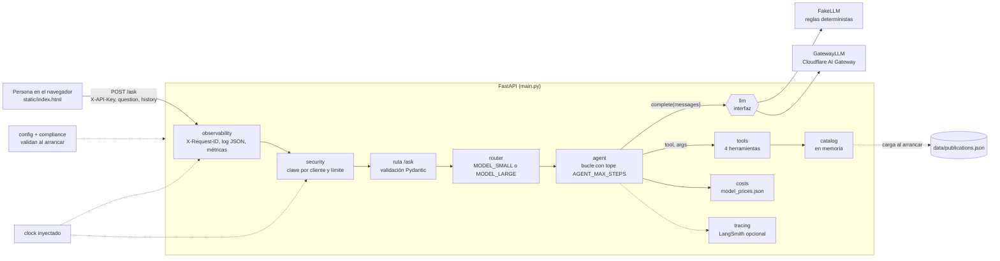

# Arquitectura del DIBM Assistant

Asistente que responde preguntas sobre los Documentos de Investigación del Banco de México a partir de un snapshot
local del sitio. Es una API FastAPI sin estado con un solo agente, cuatro herramientas de solo lectura y un modelo
intercambiable (simulado o Cloudflare AI Gateway).

## Diagrama

## Piezas

| Módulo | Responsabilidad |
| --- | --- |
| `config.py`, `compliance.py` | Leer y validar el entorno; negarse a arrancar con configuración inválida o insegura |
| `catalog.py`, `tools.py` | Snapshot en memoria y las cuatro herramientas de solo lectura |
| `llm.py`, `prompts.py` | Interfaz `complete(messages)`, modelo simulado, gateway y prompt de sistema |
| `agent.py` | Bucle con tope, protocolo JSON, ventana de historial, auditoría |
| `router.py`, `costs.py` | Elección de modelo y costo por respuesta |
| `observability.py`, `tracing.py` | Request id, log JSON, métricas por proceso, trazas opcionales |
| `security.py`, `clock.py` | Clave por cliente, límite de peticiones, reloj inyectable |
| `main.py` | `create_app()` con dependencias inyectadas y `app` real |
| `static/index.html` | Página web sin librerías; historial y clave en el navegador |

## Rutas

| Ruta | Clave | Respuesta |
| --- | --- | --- |
| `GET /` | No | Página web |
| `GET /health` | No | `status`, `pid`, `publications` |
| `POST /ask` | Sí | `answer`, `steps`, `tools_used`, tokens, `request_id`, `model`, `route`, `cached_calls`, `cost_usd` |
| `GET /metrics` | Sí | Peticiones, tasa de error, latencia p50/p95, tokens, costo, SLO |

## Despliegue

Contenedor `python:3.12-slim` con usuario no root; CI en GitHub Actions (`style`, `unit`, `e2e`, `docker`); Render
publica solo si el pipeline pasa (`autoDeployTrigger: checksPass`) con `ENVIRONMENT=production` y secretos fuera del
repositorio.

## Decisiones

Ver `doc/adr/`: 0001 API sin estado, 0002 snapshot, 0003 agente con bucle con tope, 0004 interfaz de modelo,
0005 palancas de costo, 0006 seguridad y compliance como código.
